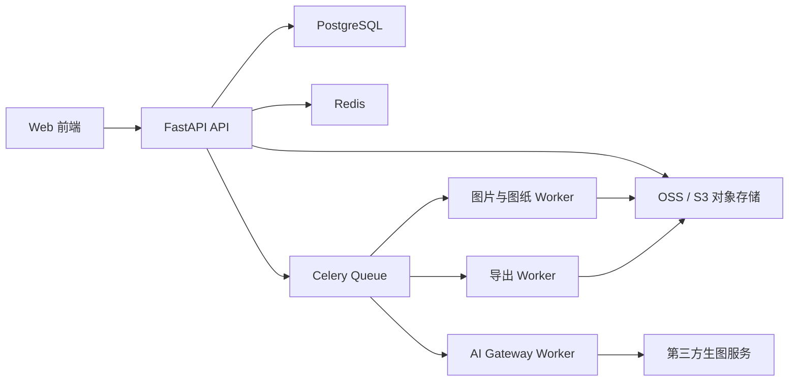

# 拼豆图纸生成平台后端开发文档

> 文档版本：V1.0  
> 文档日期：2026-08-04  
> 需求基线：[PingDou_PRD.md](./PingDou_PRD.md) V1.1  
> 开发原则：模块化单体、异步任务、幂等优先、前后端独立开发

## 1. 文档目标

本文档定义后端服务、数据模型、订单与业务码、图片处理、AI Gateway、可制造性转换引擎、图纸编辑持久化、导出任务及运维要求。

后端不得依赖前端页面或联调环境才能开发和验收。所有功能通过 OpenAPI、自动化接口测试、固定图片夹具、模拟支付渠道和模拟 AI 服务商独立验证。

## 2. 总体架构

### 2.1 MVP 架构原则

首期采用“模块化单体 API + 独立异步 Worker”，不拆分大量微服务。



模块间通过应用服务和领域事件通信。除异步 Worker 外，不通过网络调用同一代码库中的业务模块。

### 2.2 推荐技术栈

| 领域 | 推荐方案 |
| --- | --- |
| API | Python + FastAPI + Pydantic |
| ORM 与迁移 | SQLAlchemy 2 + Alembic |
| 数据库 | PostgreSQL |
| 缓存与分布式锁 | Redis |
| 异步任务 | Celery |
| 对象存储 | 阿里云 OSS、腾讯云 COS 或 S3 兼容存储 |
| 图片处理 | Pillow、OpenCV、scikit-image |
| 色差计算 | Lab + CIEDE2000 |
| PDF | ReportLab 或等价服务端库 |
| 观测 | OpenTelemetry + Prometheus + Sentry |
| 测试 | pytest + httpx + Testcontainers |

如果团队已有稳定后端栈，可以替换框架，但接口、状态机、幂等和数据约束不得改变。

## 3. 后端职责边界

### 3.1 后端负责

- 账号、订单、支付回调、业务码、服务权益和退款状态。
- 文件上传签名、文件校验、对象存储和生命周期。
- 图片分析、主体抠图、白底语义和蒙版持久化。
- AI Gateway、服务商路由、内容安全、成本记录和失败降级。
- 品牌色板、颜色量化、可制造性评分和自动修复。
- 权威图纸矩阵、版本控制、颜色统计和材料清单。
- 项目历史、自动保存冲突控制和导出文件。
- 审计日志、埋点、监控、告警和运营后台 API。

### 3.2 后端不负责

- 页面路由、Canvas 交互和前端本地撤销栈。
- 未经接口提交的浏览器本地草稿。
- 根据 UI 状态推测服务权益。
- 使用客户端上报金额作为订单金额。
- 信任客户端计算的豆子数量、编辑有效期或业务码状态。

## 4. 独立开发机制

### 4.1 契约优先

- [API_Specification.md](./API_Specification.md) 是接口语义基线。
- 后端在开发初期生成并提交 `openapi.json`。
- 每次 Schema 变更运行向后兼容检查。
- 前端需要的新字段通过新增可选字段发布，不直接修改已冻结字段。
- 接口测试不得依赖浏览器或前端仓库。

### 4.2 模拟适配器

必须提供以下可替换实现：

```text
PaymentProvider: Fake / WeChat / Alipay
AiImageProvider: Fake / Primary / Secondary
BackgroundRemovalProvider: Local / Remote
ObjectStorage: LocalMinIO / CloudOSS
SmsProvider: Fake / CloudSMS
```

本地和 CI 默认使用 Fake Provider。Fake AI Provider 根据夹具名称返回固定候选图、评分和失败场景。

### 4.3 固定夹具

后端需维护与前端一致的测试夹具：

- `portrait_clean`
- `portrait_complex`
- `pet_white_fur`
- `transparent_logo`
- `large_pattern_150`
- `code_valid`
- `code_redeemed`
- `job_retry_then_success`

固定夹具生成的色号矩阵、颜色统计和评分应保存为 Golden Files，用于算法回归测试。

## 5. 模块划分

```text
app/
  auth/
  catalog/
  orders/
  payments/
  redemption/
  entitlements/
  projects/
  assets/
  image_analysis/
  background_removal/
  ai_gateway/
  palettes/
  pattern_engine/
  pattern_editor/
  exports/
  admin/
  jobs/
  observability/
```

每个模块包含 `models`、`schemas`、`repository`、`service`、`router` 和测试。领域服务不直接访问其他模块的数据表，必须通过公开服务方法或领域事件。

## 6. 优先级开发规划

### 6.1 P0-A 工程基础、数据库和契约

目标：建立无需前端即可运行和测试的后端骨架。

交付内容：

- FastAPI、配置管理、数据库迁移、Redis、Celery 和本地对象存储。
- OpenAPI、统一响应、错误码、请求 ID、鉴权和审计中间件。
- Provider 接口与 Fake 实现。
- CI 中的单元测试、迁移测试和契约测试。
- Seed 命令，写入测试用户、商品、色板和业务码。

验收标准：

- 一条命令启动 API、Worker、PostgreSQL、Redis 和 MinIO。
- 在无第三方账号的情况下完成全部 Fake 流程。
- OpenAPI 生成结果稳定且可被前端类型生成器使用。

### 6.2 P0-B 账号、订单、支付、发码和权益

依赖：P0-A。

交付内容：

- 手机号登录、短期访问令牌和刷新令牌。
- 商品快照、订单创建、支付渠道适配和支付回调。
- 安全随机业务码生成、哈希存储、180 天有效期。
- 业务码兑换、绑定用户和项目、并发控制。
- 服务权益、AI 配额、72 小时编辑期和 30 天下载期。
- 退款作废和支付成功未发码补偿任务。

验收标准：

- 相同幂等键创建订单只返回一个订单。
- 重复支付回调只生成一个业务码。
- 同一业务码并发兑换只有一个请求成功。
- 技术失败可以恢复服务权益，不产生重复订单。

### 6.3 P0-C 文件、图片分析、抠图和白底语义

依赖：P0-A，服务权益可使用 Seed 数据。

交付内容：

- 上传初始化、分片或直传签名、上传完成确认。
- MIME、文件头、大小、分辨率、EXIF 和安全校验。
- 图片质量分析任务。
- 主体抠图、蒙版边缘处理和前景资产生成。
- 背景模式合成和预转换统计。
- 游客 24 小时、项目资产和导出资产生命周期。

验收标准：

- `WHITE_PREVIEW` 只改变预览合成，不产生白色格子。
- `SOLID_WHITE_BEADS` 必须关联品牌白色色号。
- 前景资产、蒙版资产和背景参数独立保存。
- 白色毛发夹具通过边缘质量回归测试。

### 6.4 P0-D AI Gateway 与拼豆专用 AI

依赖：P0-A、P0-C。

交付内容：

- AI 任务创建、权益检查、幂等键和成本预算。
- 拼豆约束快照：目标网格、色板、最大颜色数、轮廓和背景语义。
- 主服务商、备用服务商、熔断、超时和回调验签。
- 输入输出内容安全和自有对象存储转存。
- 候选图低成本预转换和可制造性评分。
- 全部候选低于 60 分时的一次系统自动重试。

验收标准：

- AI 失败不消耗额外业务码。
- 同一任务幂等键不会调用服务商两次。
- 服务商回调重复到达不重复写入候选资产。
- 成本、模型、服务商、耗时和评分均可审计。

### 6.5 P0-E 色板、图纸引擎和编辑持久化

依赖：P0-A、P0-C。

交付内容：

- 至少 3 套品牌色板和一套通用色板。
- 色板版本锁定、颜色启停和 Lab 数据。
- 降采样、颜色量化、CIEDE2000 匹配和颜色合并。
- 透明语义、孤立格清理、轮廓保护和自动修复。
- 可制造性评分及分项指标。
- 图纸矩阵压缩、增量编辑、版本冲突和颜色统计。

验收标准：

- 同一输入、参数和色板版本生成完全一致的矩阵。
- 总豆子数等于全部非空格数量。
- 白底展示不计豆，实体白豆背景计豆。
- 自动修复不改变锁定格。
- 固定夹具 Golden Files 回归通过。

### 6.6 P0-F 项目、自动保存、导出和运营能力

依赖：P0-B、P0-E。

交付内容：

- 项目列表、搜索、复制、软删除和恢复。
- 重要节点版本和用户手动版本。
- PNG、PDF、CSV、项目文件异步导出。
- PDF 分页、全局坐标、对齐标记和材料清单。
- 下载签名、30 天保留和重复下载。
- 订单、业务码、AI 成本和失败任务运营查询。

验收标准：

- 版本冲突返回 409，不静默覆盖。
- 导出内容与指定图纸版本一致。
- 导出失败不消耗服务权益。
- 支付、任务、导出和退款链路可通过 request_id 追踪。

### 6.7 P1

- 三方案并行生成。
- CSV 和项目文件导入。
- 自定义色板和用户库存。
- 制作进度、分区和库存缺口。
- 微信登录、更多支付渠道和优惠活动。

### 6.8 P2

- 团队空间和批量商家能力。
- AR 制作识别服务。
- 图纸授权、社区和交易。
- 算法模型训练及用户授权数据闭环。

## 7. 核心数据模型

### 7.1 订单与业务码

#### `orders`

```text
id UUID PK
user_id UUID NOT NULL
product_id UUID NOT NULL
product_snapshot JSONB NOT NULL
amount_cents INTEGER NOT NULL
channel VARCHAR NOT NULL
status VARCHAR NOT NULL
idempotency_key VARCHAR NOT NULL UNIQUE
paid_at TIMESTAMPTZ NULL
refunded_at TIMESTAMPTZ NULL
created_at TIMESTAMPTZ NOT NULL
```

#### `redemption_codes`

```text
id UUID PK
order_id UUID NOT NULL UNIQUE
code_hash BYTEA NOT NULL UNIQUE
code_ciphertext BYTEA NULL
code_hint VARCHAR NOT NULL
status VARCHAR NOT NULL
expires_at TIMESTAMPTZ NOT NULL
redeemed_at TIMESTAMPTZ NULL
user_id UUID NULL
project_id UUID NULL
version INTEGER NOT NULL DEFAULT 0
```

`code_hash` 用于兑换校验。`code_ciphertext` 使用 KMS 信封加密，仅用于未兑换阶段在订单详情中交付完整业务码，兑换、退款、作废或过期后立即清除。日志、分析系统和数据库普通字段不得保存完整明文。

#### `service_entitlements`

```text
id UUID PK
redemption_code_id UUID NOT NULL UNIQUE
project_id UUID NOT NULL UNIQUE
status VARCHAR NOT NULL
source_asset_id UUID NULL
ai_jobs_total INTEGER NOT NULL DEFAULT 1
ai_jobs_used INTEGER NOT NULL DEFAULT 0
edit_expires_at TIMESTAMPTZ NULL
download_expires_at TIMESTAMPTZ NULL
completed_at TIMESTAMPTZ NULL
version INTEGER NOT NULL DEFAULT 0
```

### 7.2 图片与项目

资产至少区分：

```text
SOURCE_IMAGE
FOREGROUND_IMAGE
SUBJECT_MASK
WHITE_PREVIEW
AI_CANDIDATE
PATTERN_PREVIEW
EXPORT_FILE
```

`base_image_versions` 保存源资产、蒙版资产、裁剪参数、背景模式和实体背景色号。已确认版本不可原地修改。

### 7.3 色板与图纸

- `palettes` 使用语义版本，例如 `MARD-2026.1`。
- `palette_colors` 存储 RGB、Lab、属性和启停状态。
- `pattern_versions` 保存参数快照、色板版本和可制造性评分。
- 网格矩阵使用 `BYTEA` 或对象存储二进制文件，采用 RLE 或压缩 TypedArray。
- `color_usage` 是服务端权威统计，可以从矩阵重建。

## 8. 状态机

### 8.1 订单

```text
PENDING_PAYMENT → PAID → REFUNDED
PENDING_PAYMENT → CLOSED
```

支付渠道回调只允许推进状态，不允许从 `REFUNDED` 回退到 `PAID`。

### 8.2 业务码

```text
UNREDEEMED → BOUND → IN_SERVICE → GENERATED → COMPLETED
UNREDEEMED/BOUND → VOIDED
UNREDEEMED → EXPIRED
```

### 8.3 服务权益

```text
AVAILABLE → ACTIVE → GENERATED → COMPLETED
ACTIVE → AVAILABLE          技术失败恢复
AVAILABLE/ACTIVE → VOIDED   退款或违规
```

权益变更必须使用数据库事务、行锁或乐观锁，并写入 `entitlement_events` 审计表。

### 8.4 异步任务

```text
QUEUED → RUNNING → REVIEWING → SUCCEEDED
QUEUED/RUNNING/REVIEWING → FAILED
QUEUED/RUNNING → CANCELLED
```

## 9. 支付、发码与兑换

### 9.1 创建订单

- 客户端只提交 `productId` 和支付渠道。
- 金额、服务范围、编辑期和 AI 配额从服务端商品配置读取并写入订单快照。
- `Idempotency-Key` 必填，有效期至少 24 小时。

### 9.2 支付回调

- 验证渠道签名、商户号、订单号、金额和支付状态。
- 在同一事务内推进订单状态并写入 Outbox 事件。
- 发码由 Outbox Consumer 完成，失败进入补偿队列。
- 重复回调返回成功，但不重复发码。

### 9.3 业务码生成

- 使用密码学安全随机数，至少 80 bit 熵。
- 展示字符排除 `O、0、I、1`。
- 存储前使用带服务端 Pepper 的 HMAC 或慢哈希。
- 完整码仅保存 KMS 加密副本用于未兑换阶段交付，兑换、退款、作废或过期后清除。
- 保存后四位或分段 Hint，用于客服定位。

### 9.4 兑换

兑换事务内完成：

1. 校验用户和手机号绑定。
2. 校验业务码哈希、状态和有效期。
3. 锁定业务码行。
4. 创建项目和服务权益。
5. 绑定用户、项目和兑换时间。
6. 写入审计事件。

同一业务码重复兑换时，如果请求用户就是已绑定用户，则返回关联项目；否则返回 `CODE_ALREADY_REDEEMED`。

## 10. 文件与对象存储

### 10.1 上传流程

```text
upload-init → 客户端直传对象存储 → upload-complete → 服务端校验 → Asset 可用
```

- 上传初始化返回一次性对象 Key 和短期签名。
- 上传完成时验证对象存在、大小、哈希、MIME 和图片解码。
- 客户端提供的 MIME 和扩展名仅作参考。
- 原文件名经过清理后只作为展示字段。

### 10.2 存储 Key

```text
users/{userId}/projects/{projectId}/source/{assetId}
users/{userId}/projects/{projectId}/derived/{assetId}
users/{userId}/projects/{projectId}/exports/{exportId}
```

### 10.3 生命周期

- 游客未兑换资产：24 小时。
- 登录项目源图和派生图：项目存续期间保留。
- 导出文件：默认 30 天。
- 软删除项目：回收站 30 天。
- 永久删除通过异步清理任务执行并记录审计日志。

## 11. 抠图与白底处理

### 11.1 数据语义

抠图任务输出：

- 前景 RGBA 图片。
- 8 bit Alpha 蒙版。
- 边缘质量评分。
- 建议裁剪区域。
- 白底预览缩略图。

白底预览是派生展示资产，不得作为权威前景数据覆盖蒙版。

### 11.2 背景模式

| 模式 | 转换输入 | 背景是否计豆 |
| --- | --- | --- |
| `WHITE_PREVIEW` | 前景 + 透明背景 | 否 |
| `TRANSPARENT` | 前景 + 透明背景 | 否 |
| `KEEP_ORIGINAL` | 原图 | 是 |
| `SOLID_WHITE_BEADS` | 前景 + 指定白色色号 | 是 |
| `SOLID_CUSTOM_BEADS` | 前景 + 指定色号 | 是 |

所有图纸任务必须读取背景模式，不能通过图片像素颜色推断背景语义。

### 11.3 边缘处理

- 提供保留、标准、强力三档阈值。
- 对白色毛发和半透明区域保留软 Alpha。
- 在进入图纸转换前，根据目标网格执行一次蒙版下采样。
- 白色主体与白底对比不足时，生成轮廓保护建议，不直接添加黑边。

## 12. AI Gateway

### 12.1 统一请求

AI Gateway 接收：

```text
source_asset_id
subject_mask_asset_id
style
composition
similarity
detail_level
background_mode
target_grid
palette_id + palette_version
max_colors
outline_protection
```

### 12.2 Provider 路由

- 根据风格、成本预算、服务健康度和地区选择主 Provider。
- 单次任务只允许自动切换备用 Provider 一次。
- Provider 超时和回调迟到需要使用任务版本防止覆盖已成功结果。
- 所有候选图转存自有对象存储后才对用户可见。

### 12.3 成本控制

- 创建任务时预估成本并锁定权益配额。
- 成功后记录实际成本，技术失败释放配额。
- 系统自动质量重试不计为用户主动追加，但计入成本看板。
- 当单码成本超过运营阈值时告警，不自动向用户扣费。

### 12.4 内容安全

- 输入图片、生成参数和结果均进行审核。
- 审核结果使用标准原因码，不暴露第三方原始文本。
- 违规任务不进入候选图列表，权益处理按购买协议执行。

## 13. 可制造性转换引擎

### 13.1 处理流水线

1. 按目标网格和蒙版执行区域采样。
2. 在 Lab 色彩空间进行预量化。
3. 映射到锁定版本的品牌色板。
4. 根据颜色合并强度减少相近色。
5. 保护脸部、眼睛、文字和外轮廓。
6. 清理低价值孤立格和小色块。
7. 检测脆弱连接和断裂区域。
8. 计算材料统计和可制造性分项得分。
9. 生成原始版本与自动修复版本。

### 13.2 评分

```text
总分 =
  主体辨识度 × 30%
  + 关键轮廓完整度 × 20%
  + 颜色经济性 × 20%
  + 色块连通性 × 20%
  + 制作成本与尺寸 × 10%
```

每个分项保存算法版本和特征摘要，便于后续回放。评分算法升级不得改变历史图纸版本的显示结果。

### 13.3 确定性

- 输入资产哈希、蒙版版本、参数、色板版本和算法版本共同组成缓存 Key。
- 相同 Key 必须生成相同矩阵。
- AI 图像本身可以非确定，但进入图纸引擎后必须确定。
- 算法升级通过显式 `engine_version` 发布。

## 14. 图纸矩阵与编辑

### 14.1 矩阵编码

- 色板索引 `0` 为空格。
- MVP 使用 `uint16` 存储色板索引。
- 锁定格使用独立 Bitset。
- 持久化采用压缩二进制，响应可使用 Base64 压缩或短期下载 URL。

### 14.2 增量编辑

- 请求必须包含 `operationId`、`patternVersion` 和变更列表。
- `operationId` 在项目范围唯一。
- 版本一致时应用变更、增量更新统计并递增版本。
- 已处理的 `operationId` 返回原结果。
- 版本不一致返回 409 和当前版本号。

### 14.3 统计

- 非空格数量是净豆子总量。
- `WHITE_PREVIEW` 和 `TRANSPARENT` 背景不产生格子。
- 建议准备量使用 `ceil(net_count × (1 + waste_rate))`。
- 增量编辑优先增量更新，定期异步全量校验。

## 15. 导出

### 15.1 输入快照

导出任务必须锁定：

- 图纸版本。
- 色板版本。
- 背景模式。
- 页面、方向、坐标和网格配置。
- 水印和材料表配置。

### 15.2 格式

- PNG：高分辨率颜色、网格、色号和坐标。
- PDF：A4/A3、分页、全局坐标、页码、重叠边界和材料表。
- CSV：二维色号矩阵和颜色统计。
- 项目文件：参数、色板索引、压缩矩阵和校验和。

### 15.3 下载

- 下载 URL 使用短期签名。
- 导出资产默认保存 30 天。
- 相同图纸版本和导出参数可以复用成功结果。
- 导出失败不改变权益或完成状态。

## 16. 安全与合规

- 全部外部接口使用 HTTPS。
- JWT、支付密钥、业务码 Pepper 和 Provider 密钥存储在密钥管理服务。
- 业务码、手机号、对象存储签名和支付回调不得写入普通日志。
- 上传文件执行内容类型、解码和安全检查。
- 对象存储使用私有 Bucket。
- 管理后台接口使用独立权限和审计日志。
- 原图默认不用于训练；单独授权必须可撤销和审计。
- 用户永久删除任务需要清理数据库引用和对象存储资产。

## 17. 可靠性与幂等

### 17.1 必须幂等的操作

- 创建订单。
- 支付回调。
- 发放业务码。
- 兑换业务码。
- 创建 AI、抠图、图纸和导出任务。
- 增量保存操作。
- Provider 回调。

### 17.2 Outbox

订单支付、发码、权益变更和退款采用事务 Outbox，避免数据库提交成功但消息未发送。

### 17.3 重试

- 只对网络错误、超时和明确可重试错误自动重试。
- 内容违规、参数错误和配额不足不自动重试。
- 重试使用指数退避和最大次数。
- 死信任务进入运营后台，可人工补偿。

## 18. 性能目标

- 普通 API P95 小于 300 ms，不含异步处理时间。
- 100×100 图纸生成 P95 小于 8 秒。
- 图纸增量保存 P95 小于 500 ms。
- PNG 导出 P95 小于 10 秒。
- 多页 PDF 导出 P95 小于 30 秒。
- 单个 Worker 任务必须设置内存和超时限制。
- 300×300 图纸不得逐格写入数据库行。

## 19. 可观测性

所有日志和 Trace 使用：

```text
request_id
trace_id
user_id
order_id
entitlement_id
project_id
job_id
provider
engine_version
```

敏感值只能记录掩码或内部 ID。

核心监控：

- 支付成功率、发码延迟和补偿队列长度。
- 业务码兑换成功率和并发冲突数。
- 单码平均成本、AI 重试率和 Provider 成功率。
- 抠图边缘质量分布。
- 可制造性评分和用户修改率。
- 图纸生成、保存和导出 P95。
- 权益恢复、退款和人工补偿数量。

## 20. 测试策略

### 20.1 单元测试

- 状态机和权益规则。
- 业务码生成、哈希和有效期。
- 背景模式与计豆规则。
- CIEDE2000、颜色合并和评分函数。
- RLE 编码、解码和增量统计。

### 20.2 集成测试

- PostgreSQL 事务、行锁和唯一约束。
- Redis 锁和 Celery 重试。
- MinIO 上传、下载和生命周期。
- Fake Payment、Fake AI 和 Fake SMS。
- OpenAPI 请求响应 Schema。

### 20.3 并发测试

- 重复支付回调。
- 同一业务码 20 个并发兑换请求。
- 同一图纸版本并发保存。
- 同一 Provider 回调重复投递。

### 20.4 Golden File 测试

每个算法夹具保存：

- 输入资产哈希。
- 参数和色板版本。
- 输出矩阵校验和。
- 颜色统计。
- 可制造性评分。
- 预期背景计豆语义。

算法修改必须显式更新引擎版本，不能无说明覆盖 Golden Files。

## 21. 部署与环境

| 环境 | Provider | 数据 |
| --- | --- | --- |
| Local | 全部 Fake + MinIO | Seed 数据 |
| Test | Fake 为主 | 自动清理 |
| Staging | 沙箱支付 + 测试 AI | 脱敏数据 |
| Production | 正式 Provider | 生产数据 |

部署顺序：数据库迁移、API、Worker、定时任务。部署失败时数据库迁移必须可向前兼容旧 API，避免前后端发布顺序耦合。

## 22. 后端完成定义

一个 P0 功能只有满足以下条件才算完成：

- OpenAPI Schema 和 [API_Specification.md](./API_Specification.md) 一致。
- 单元、集成、并发和契约测试通过。
- Fake Provider 下可独立演示完整流程。
- 幂等、重试、补偿和审计已实现。
- 数据库迁移可重复执行并有回滚或修复方案。
- 关键指标、日志、Trace 和告警已配置。
- 不依赖前端传递权威金额、统计或权益状态。
- 对应固定夹具的 Golden File 回归通过。
