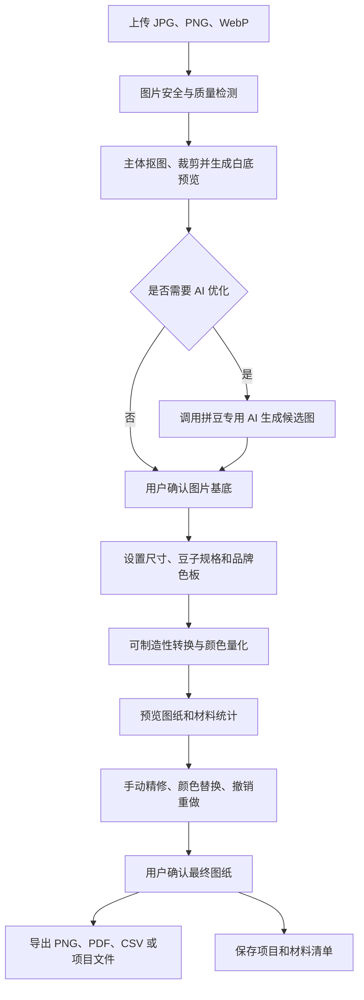

# 拼豆图纸生成与 AI 美化平台 PRD

> 文档版本：V1.1  
> 文档日期：2026-08-03  
> 产品形态：Web 优先，后续支持小程序与桌面端  
> 参考产品：[草莓拼豆底稿生成器](https://xiaoana.cn/)
> 本次更新：增加可制造性转换引擎、拼豆专用 AI、抠图加白底服务和 ToC 业务码规则

## 1. 文档目的

本文档定义一款面向拼豆爱好者、手作商家和图纸设计师的图片转拼豆图纸产品。用户上传图片后，系统先判断图片是否适合直接转为拼豆图，必要时推荐使用 AI 生图服务进行二次美化，例如真人照片转动漫、主体抠图、背景简化、轮廓增强等。用户确认最终图片基底后，系统将图片转换为可实际制作的拼豆方格图，并生成色号、颜色用量、坐标、材料清单和可打印图纸。

本文档用于统一产品、设计、前端、后端、算法、测试和运营团队的实现范围及验收标准。

## 2. 产品背景

普通图片不能直接用于拼豆制作，主要存在以下问题：

- 真人照片的光影、肤色和背景颜色过多，直接像素化后容易产生大量杂色。
- 图片主体可能过小、边缘不清晰或背景复杂，转换后难以辨认。
- 用户通常不了解网格尺寸、豆子品牌色板和成品物理尺寸之间的关系。
- 普通像素化工具只生成像素图，无法提供品牌色号、每色用量和可打印坐标图纸。
- 自动转换后仍需要局部修图、颜色合并、替换杂色和手动补充轮廓。
- 大尺寸图纸需要分页、定位和材料清单，否则制作成本较高。

参考站点已经验证了品牌色板、自动计数、图纸下载、手动编辑、网格调节、颜色合并、色号/坐标显示、颜色高亮、整色替换、草稿历史等需求。本产品在此基础上增加 AI 二次美化判断、生成式图片确认链路、材料采购辅助和更完整的项目管理能力。

## 3. 产品定位

### 3.1 一句话定位

从任意图片到可实际制作的拼豆图纸，通过主体抠图、拼豆专用 AI 和可制造性引擎，一站完成白底基底、色板匹配、用量统计、精修和交付。

### 3.2 核心价值

- 降低门槛：用户不需要理解像素化、色差算法或图纸排版。
- 提升成品效果：在转图前主动识别不适合拼豆化的图片，并提供 AI 美化方案。
- 保证可制作性：所有输出均基于真实品牌色板、网格尺寸和豆子库存。
- 降低材料浪费：实时统计每种颜色用量，并支持损耗预留。
- 提高精修效率：提供高亮、批量替换、填充、画笔、撤销重做等工具。

### 3.3 差异化定位与产品护城河

本产品不以“把图片变成像素图”为唯一卖点，而是围绕真实拼豆制作结果建立三层差异化：

1. **可制造性转换引擎**：同时优化图案辨识度、颜色数量、色块连通性、材料成本和制作难度，输出的是可以实际摆放和制作的图纸。
2. **拼豆专用 AI 设计师**：AI 生成时直接受目标网格、豆子规格、品牌色板、最大颜色数和轮廓保护约束，避免先生成漂亮图片、再被动压缩成低质量图纸。
3. **抠图加白底出图服务**：先提取主体并自动修复边缘，再以白色画布展示和生成图纸。白色展示背景与需要实际铺白豆的实体背景分离，减少误用白豆和统计错误。

长期数据资产包括用户最终选择的 AI 候选图、人工修改的格子、被替换的颜色、最终导出结果和制作反馈。数据将用于优化可制造性评分、颜色合并和 AI 结果评测，形成持续的数据飞轮。

### 3.4 目标用户

| 用户类型 | 典型需求 | 核心关注点 |
| --- | --- | --- |
| 拼豆新手 | 将头像、宠物、动漫图转成图纸 | 操作简单、效果直观、材料数量准确 |
| 进阶爱好者 | 控制色板、尺寸并精修图纸 | 色号准确、编辑效率、导出质量 |
| 手作商家 | 批量接单、计算材料和保存客户项目 | 批量生产、项目复用、成本估算 |
| 图纸设计师 | 从空白画布创作和销售图纸 | 编辑能力、版权标记、多格式导出 |

## 4. 产品目标与非目标

### 4.1 首期目标

- 完成图片上传、质量分析、AI 美化建议和图片基底确认。
- 支持至少 3 套真实品牌色板及一套通用色板。
- 建立可制造性评分和自动修复能力，降低用户手动修改量。
- AI 生成结果必须遵守目标网格和色板约束，并通过拼豆可制造性校验。
- 默认提供“主体抠图加白底预览”，并允许用户明确选择白底是否参与铺豆统计。
- 生成带网格、色号、坐标和颜色统计的拼豆图纸。
- 支持核心手动精修能力并实时更新用量。
- 支持 PNG、PDF、CSV 和项目文件导出。
- 支持账号项目历史、自动保存和再次编辑。

### 4.2 首期非目标

- 不提供实体拼豆或工具的自营电商履约。
- 不提供复杂的专业位图编辑能力，例如图层蒙版、曲线和通道。
- 不保证 AI 美化结果与真人完全一致，只保证用户可预览和确认。
- 不在首期支持多人实时协同编辑。
- 不在首期开放用户图纸交易市场。

## 5. 成功指标

### 5.1 北极星指标

每周成功导出的有效拼豆项目数。

“有效拼豆项目”定义为完成图片基底确认、生成图纸并至少导出一次的项目。

### 5.2 核心指标

| 指标 | 首期目标 |
| --- | --- |
| 上传到首次预览成功率 | ≥ 95% |
| 图片基底确认率 | ≥ 70% |
| 图纸生成成功率 | ≥ 98% |
| 图纸生成 P95 耗时 | ≤ 8 秒，100×100 网格以内 |
| AI 美化任务 P95 耗时 | ≤ 90 秒，超时可重试或切换服务商 |
| AI 候选图可制造性校验通过率 | ≥ 85%，评分达到 60 分 |
| 默认方案可制造性平均分 | ≥ 80 分 |
| 用户人工修改格子比例 | 首期中位数 ≤ 5% |
| 生成到导出转化率 | ≥ 45% |
| 业务码兑换到成功导出转化率 | ≥ 70% |
| 项目自动保存成功率 | ≥ 99.5% |
| 豆子统计准确率 | 100%，以最终非透明格数量为准 |

## 6. 核心业务流程



### 6.1 关键产品原则

1. 原图永远保留，AI 结果和后续版本均作为新版本保存。
2. 系统可以推荐美化，但不得未经确认直接调用付费生图服务。
3. 用户必须确认图片基底后才能进入最终拼豆转换。
4. 所有颜色统计必须基于当前最终画布，编辑后实时重算。
5. 默认优先保证图案可辨认和可制作，而不是追求照片级颜色还原。
6. 白色画布默认只代表预览和打印纸张，不自动代表需要铺白色豆子。

## 7. 功能范围总览

| 模块 | P0 首发 | P1 增强 | P2 规划 |
| --- | --- | --- | --- |
| 图片上传与基础编辑 | 上传、旋转、裁剪、缩放、抠图、白底预览 | 批量上传、智能构图 | 云盘导入 |
| 图片质量判断 | 清晰度、主体、背景、颜色复杂度分析 | 用户偏好学习 | 自动多方案 A/B 推荐 |
| AI 二次美化 | 拼豆专用约束、真人转动漫、背景简化、轮廓增强、重绘 | 风格模板、自定义提示词 | 专属角色一致性模型 |
| 拼豆转换 | 可制造性评分、网格化、色板匹配、颜色合并、统计 | 自动修复、智能杂色清理 | 基于用户修改数据的多目标优化算法 |
| 手动编辑 | 画笔、橡皮、填充、吸管、替换、撤销重做 | 选区、镜像、旋转、复制粘贴 | 图层与多人协作 |
| 图纸展示 | 色号、坐标、网格、高亮 | 分区制作模式、进度打勾 | AR 辅助制作 |
| 导出 | PNG、PDF、CSV、项目文件 | 商用水印、批量导出 | 图纸商城发布 |
| 项目管理 | 自动保存、历史记录、搜索、复制 | 标签、文件夹、版本对比 | 团队空间 |
| 材料清单 | 色号、净用量、损耗量、总量 | 库存扣减、缺料清单 | 电商一键采购 |

## 8. 详细功能需求

### 8.1 首页与项目入口

#### 8.1.1 首页操作

- 主操作为“上传图片制作图纸”。
- 次操作为“创建空白拼豆画布”。
- 支持拖拽上传和点击选择文件。
- 登录用户可进入“我的项目”，查看草稿和已完成图纸。
- 首页展示最近项目，最多 6 个；未登录用户不展示。
- 导出按钮在未生成图纸前禁用，并说明禁用原因。

#### 8.1.2 文件限制

- 支持 JPG、JPEG、PNG、WebP。
- 单文件最大 20 MB。
- 最短边不得低于 128 px，低于时提示清晰度风险，但允许继续。
- 最大分辨率 12000×12000，超出后在本地或服务端等比缩放。
- EXIF 方向信息需要自动纠正。
- 含透明通道的图片保留透明区域，透明格默认不计入豆子数量。

### 8.2 图片理解与二次美化判断

#### 8.2.1 分析维度

系统上传后执行视觉分析，输出 0 至 100 的“直接转图适配度”，并识别：

- 图片清晰度和压缩噪点。
- 主体数量、主体占比和主体位置。
- 人脸或宠物脸部是否过小、遮挡或模糊。
- 背景复杂度和前景背景分离难度。
- 颜色数量、相近色数量、阴影和渐变复杂度。
- 主体轮廓完整度、边缘对比度。
- 图片内容安全与版权风险提示。

#### 8.2.2 判断结果

| 结果 | 条件示例 | 产品动作 |
| --- | --- | --- |
| 可直接转换 | 主体清晰、背景简单、颜色层次有限 | 默认推荐直接进入裁剪确认 |
| 建议轻度优化 | 背景杂乱、主体偏小、颜色过多 | 先抠图并生成白底预览，再决定是否进行 AI 优化 |
| 建议 AI 重绘 | 真人照片光影复杂、写实宠物、低清图片 | 推荐使用受网格和色板约束的动漫化、卡通化或高清重绘 |
| 无法处理 | 文件损坏、内容违规、主体不可辨认 | 阻止生成并提示更换图片 |

#### 8.2.3 用户确认机制

- 分析结果必须说明“为什么推荐美化”，不能只显示分数。
- 用户可选择“直接使用原图”“使用推荐优化”“自定义美化”。
- 所有图片默认先进入“抠图加白底预览”步骤，用户可切换透明背景或保留原背景。
- 调用生图服务前展示该任务是否包含在当前业务码权益内、预计耗时和数据处理说明；需要追加费用时必须先确认支付。
- 用户确认后才创建生图任务。
- AI 失败时原图流程仍可继续，不得阻塞整个项目。

### 8.3 AI 二次美化

#### 8.3.1 拼豆专用 AI 设计师

AI 美化任务创建前，系统需要将拼豆制作约束一并传入 AI Gateway，而不是只传入风格提示词。约束至少包括：

- 目标网格宽高或建议网格区间。
- 豆子规格和预计成品尺寸。
- 指定品牌色板及允许使用的色号范围。
- 最大颜色数和颜色合并强度。
- 主体轮廓、脸部、眼睛、文字等关键区域保护信息。
- 白底展示、透明留空或实体白豆填充的背景语义。
- 小色块、渐变、阴影和高频纹理的简化要求。

AI 输出仍然是候选图片基底，最终必须经过可制造性转换引擎进行色板映射、孤立格清理和可制作性校验。不得将未经校验的 AI 图片直接作为最终图纸交付。

#### 8.3.2 首发能力

- 真人转动漫头像。
- 真人转扁平卡通插画。
- 宠物卡通化。
- 自动抠出主体并替换为纯色或透明背景。
- 简化复杂背景。
- 高清修复和去噪。
- 增强主体轮廓和局部对比度。
- 限制颜色层次，生成更适合拼豆化的插画效果。

#### 8.3.3 风格参数

- 风格：动漫、Q 版、扁平插画、像素艺术、保留写实。
- 背景：白底展示、透明留空、保留原背景、简化背景、实体纯色背景。
- 相似度：低、中、高，默认高。
- 细节等级：简洁、标准、丰富，默认标准。
- 构图：头像、半身、全身、原图构图。
- 输出比例：原图、1:1、3:4、4:3、16:9。

#### 8.3.4 结果管理

- 默认生成 2 张候选图；用户主动额外生成前需要购买追加 AI 候选图权益。
- 候选图支持原图对比、放大查看和设为基底。
- 每次生成记录模型、参数、提示词模板、服务商任务 ID 和耗时。
- 用户设为基底后仍可回退至任何历史版本。
- 不向普通用户直接展示内部系统提示词。

#### 8.3.5 生图服务接入要求

- 通过统一 AI Gateway 接入，不允许业务前端直接调用第三方服务。
- 支持主服务商和备用服务商，主服务连续失败时自动降级。
- 任务采用异步队列，前端轮询或通过 WebSocket/SSE 获取进度。
- 服务端设置任务幂等键，避免重复扣费和重复生成。
- 对上传图片、提示词和生成结果执行内容安全检测。
- 服务商回调必须验签，结果下载后转存至自有对象存储。

#### 8.3.6 AI 结果可制造性校验

每张 AI 候选图在展示给用户前，需要执行一次低成本预转换并返回：

- 可制造性总分，范围 0 至 100。
- 预计使用颜色数、豆子总数和孤立格比例。
- 主体辨识度、关键轮廓完整度和背景复杂度。
- 在当前色板下的平均色差。
- 预计需要人工修改的格子数量区间。

低于 60 分的候选图默认不作为推荐结果；60 至 79 分标记为“建议调整”；80 分及以上标记为“适合制作”。如果全部候选图低于 60 分，系统应自动调整约束重试一次，技术重试不消耗用户额外服务权益。

### 8.4 图片基底确认

用户选定原图或 AI 图后进入基底确认页。

#### 8.4.1 操作能力

- 自由裁剪、固定比例裁剪。
- 旋转 90°、水平镜像、垂直镜像。
- 缩放和移动主体。
- 一键抠图或恢复背景。
- 背景填充为透明或指定色。
- 显示预计拼豆轮廓预览。
- 恢复为当前版本原始状态。

#### 8.4.2 确认要求

- 明确显示“此图片将作为拼豆转换基底”。
- 确认后创建不可变的基底版本 ID。
- 后续修改裁剪或更换基底时，需要重新生成拼豆图，但保留旧图纸版本。

#### 8.4.3 抠图加白色背景服务

抠图结果必须以“前景主体、前景蒙版、背景显示层”三部分保存，不能只保存一张已经合成白色像素的图片。这样可以区分白色展示背景和实体白豆背景。

背景模式包括：

| 模式 | 画面效果 | 是否统计背景豆子 | 默认用途 |
| --- | --- | --- | --- |
| 白底展示 | 主体显示在白色画布上，背景实际保持透明 | 否 | 默认模式、头像和宠物图 |
| 透明留空 | 主体外区域透明 | 否 | 异形图案和后续设计 |
| 保留原背景 | 使用上传图片的原背景 | 是 | 风景、完整场景 |
| 实体白豆背景 | 背景映射为用户所选品牌的白色色号 | 是 | 方形满铺作品 |
| 自定义实体背景 | 背景映射为指定品牌色号 | 是 | 统一底色作品 |

业务规则：

- 默认使用“白底展示”，白色画布只用于视觉预览和 PDF 纸张，不计入白色豆子数量。
- 用户开启“背景也铺豆”后，必须选择具体品牌白色色号，背景格才参与颜色统计和材料清单。
- 系统需要处理头发、宠物毛发、半透明边缘和白色主体边缘，避免白边、黑边和主体缺损。
- 提供“边缘保留、标准、强力去背景”三个强度档位，并支持局部恢复和擦除蒙版。
- 白色衣服、白色宠物或浅色主体与白底接近时，必须增加轮廓线或阴影保护提示。
- 切换背景模式后需要重新执行预转换并实时更新豆子总数、颜色数和预计成品效果。
- PNG 和 PDF 导出必须携带背景语义，不能因白色纸张或查看器背景而错误增加白豆。

### 8.5 拼豆参数设置

#### 8.5.1 网格尺寸

支持三种设置方式：

1. 按横向格子数设置，纵向按图片比例自动计算。
2. 按成品物理尺寸设置，结合豆子直径自动计算格子数。
3. 使用常见底板预设，例如 29×29、58×58、87×87。

参数范围：

- 横向或纵向最小 10 格，最大 300 格。
- 首发建议 20 至 150 格，超过 150 格提示性能和打印页数影响。
- 豆子规格支持 2.6 mm、5 mm 和自定义规格。
- 实时显示预计成品宽高、总格数和预计制作难度。

#### 8.5.2 品牌色板

- 支持通用色板和运营配置的品牌色板。
- 首发至少配置 MARD、COCO、MANMAN、PANPAN、MiXiaoWo 中的 3 套，具体取决于色卡数据授权和校准结果。
- 色板包含品牌、系列、色号、名称、RGB、Lab、是否透明、是否荧光、是否夜光、可用状态。
- 用户可关闭不拥有的颜色，算法只使用已启用色号。
- 支持设置最大使用颜色数，默认 24 色，范围 2 至 120 色。
- 色板数据需标记版本，项目保存时锁定色板版本，避免后续色卡变更导致图纸漂移。

#### 8.5.3 高级参数

- 颜色合并强度：0 至 100，默认 30；数值越大，相近颜色合并越多。
- 抖动模式：关闭、轻度、标准；默认关闭，避免产生难以制作的散点杂色。
- 轮廓增强：关闭、轻度、标准、强。
- 小色块清理：最小连通区域 1 至 20 格，默认 2 格。
- 透明区域处理：留空、填充背景色、自动补全。
- 肤色保护：真人图片默认开启，避免肤色过度合并。

### 8.6 图像网格化与色板匹配

#### 8.6.1 处理流程

1. 根据目标格数计算输出网格。
2. 对裁剪后的基底图进行区域采样和降采样。
3. 在 Lab 色彩空间执行颜色量化。
4. 将量化颜色映射到用户选择的品牌色板。
5. 根据颜色合并强度合并相近色。
6. 清理孤立像素和小面积杂色块。
7. 根据轮廓增强参数恢复关键边缘。
8. 生成二维色号矩阵及实时统计数据。

#### 8.6.2 算法约束

- 色差优先采用 CIEDE2000，不以 RGB 欧氏距离作为最终匹配依据。
- 相同输入、色板版本和参数必须生成一致结果。
- 透明格使用空值，不得自动统计为白色豆子。
- 手动锁定的格子在重新优化颜色时不得被覆盖。
- 大面积纯色区域不得因抖动生成无意义散点。

#### 8.6.3 多方案预览

首次生成可以并行展示以下 3 个方案：

- 还原优先：颜色较多，接近原图。
- 均衡方案：默认推荐，兼顾还原度和制作难度。
- 简洁优先：颜色较少，杂色较少。

每个方案显示颜色数、豆子总数、预计尺寸和色差评分。用户选择一个方案进入编辑器。

#### 8.6.4 可制造性转换引擎

转换引擎需要同时优化视觉还原和实际制作，不以单一色差作为最优结果。每个方案返回以下评分：

| 评分维度 | 建议权重 | 说明 |
| --- | ---: | --- |
| 主体辨识度 | 30% | 人脸、宠物、标志和主要形状是否可识别 |
| 关键轮廓完整度 | 20% | 眼睛、嘴部、外轮廓和文字笔画是否连续 |
| 颜色经济性 | 20% | 颜色数量、相近色冗余和材料采购复杂度 |
| 色块连通性 | 20% | 孤立格、断裂区域和单格噪点比例 |
| 制作成本与尺寸 | 10% | 豆子总量、底板数量和预计成品尺寸 |

自动修复能力包括：

- 合并低价值相近色，并优先使用用户启用或已有库存的色号。
- 清理不影响主体辨识度的孤立格和小色块。
- 修复被颜色量化破坏的眼睛、嘴部、文字和外轮廓。
- 检测只有单格连接的脆弱区域，并提供加固建议。
- 在白底展示模式下保护主体边缘，不允许将透明区域错误映射为白豆。
- 在实体背景模式下优先保持背景色连续，减少无意义散点。
- 输出“自动修复前后”对比，允许用户撤销全部自动修复。

用户可选择“还原优先、均衡、制作优先”三种目标。默认使用均衡模式。系统应记录自动生成版本与最终用户版本之间的格子差异，用于离线评测颜色合并、轮廓修复和可制造性评分，但不得将用户原图用于模型训练，除非用户单独授权。

### 8.7 拼豆图纸编辑器

#### 8.7.1 页面布局

- 顶部：返回、项目名、保存状态、撤销、重做、导入、导出。
- 左侧工具栏：选择、画笔、橡皮、填充、吸管、矩形、颜色替换、移动。
- 中央画布：拼豆网格、坐标、缩放和制作预览。
- 右侧面板：色板、颜色统计、图层式显示设置、参数调整。
- 底部状态栏：当前坐标、当前色号、缩放比例、网格尺寸和豆子总数。

#### 8.7.2 编辑工具

| 工具 | 行为 |
| --- | --- |
| 画笔 | 将单格或笔刷范围修改为当前色号 |
| 橡皮 | 将格子设置为空，不计入用量 |
| 油漆桶 | 填充相邻同色区域 |
| 吸管 | 从画布读取色号并设为当前颜色 |
| 矩形 | 绘制实心或空心矩形 |
| 选区 | 移动、复制、删除选中区域 |
| 整色替换 | 将图中某一色号全部替换为另一色号 |
| 高亮颜色 | 仅高亮选中色号，其余颜色降低透明度 |
| 锁定颜色 | 锁定指定色号或格子，避免批量调整覆盖 |
| 撤销/重做 | 首发保留最近 100 步操作 |

#### 8.7.3 显示控制

- 显示或隐藏网格线。
- 显示或隐藏格内色号。
- 显示或隐藏行列坐标。
- 显示原图叠加，可调叠加透明度。
- 切换“颜色预览”和“打印图纸”视图。
- 缩放范围 10% 至 3200%，支持鼠标滚轮和触控板。
- 画布平移不得改变项目内容。

#### 8.7.4 实时统计

每次编辑后更新：

- 当前颜色数。
- 有效豆子净用量。
- 每个品牌色号的净用量。
- 加损耗后的建议准备量。
- 新增或减少的豆子数量。
- 用户库存不足数量，P1 支持。

### 8.8 颜色与材料清单

#### 8.8.1 色号统计表

| 字段 | 说明 |
| --- | --- |
| 颜色色块 | 真实显示色，仅用于屏幕参考 |
| 品牌及系列 | 对应品牌色板 |
| 色号 | 制作与采购的主要标识 |
| 颜色名称 | 运营维护的标准名称 |
| 净用量 | 画布中该色号实际格数 |
| 损耗率 | 默认 5%，用户可设置 0% 至 20% |
| 建议准备量 | `ceil(净用量 × (1 + 损耗率))` |
| 占比 | 该颜色净用量 / 全部豆子净用量 |

#### 8.8.2 统计规则

- 每个非透明、非空格子对应 1 颗豆子。
- 总豆子数必须等于所有色号净用量之和。
- 更换色板、批量替换或手动编辑后立即重新统计。
- 建议准备量只用于材料清单，不改变图纸净用量。
- 支持按色号、用量、色系排序。
- 支持隐藏当前用量为 0 的颜色。

### 8.9 制作辅助模式

#### 8.9.1 分区制作

- 按底板尺寸将大图切分为多个区域。
- 用户可以标记区域“未开始、制作中、已完成”。
- 支持逐行或逐列制作模式。
- 当前行、列或区域高亮，其他区域弱化。
- P1 支持逐格点击完成和进度统计。

#### 8.9.2 坐标规则

- 列使用数字 1、2、3；行使用数字或字母，可配置。
- 大图分页时坐标必须使用全局坐标，不能在每页重新从 1 开始。
- 每隔 5 格或 10 格显示加粗辅助线，默认 10 格。

### 8.10 导出

#### 8.10.1 导出格式

| 格式 | 内容 | 主要用途 |
| --- | --- | --- |
| PNG | 高清彩色图纸，可带网格、色号、坐标和水印 | 手机查看、分享 |
| PDF | A4/A3 单页或分页图纸、对齐标记、图例和材料表 | 打印制作 |
| CSV | 二维色号矩阵及颜色统计表 | 二次加工、跨工具导入 |
| JSON/项目文件 | 基底版本、参数、色板版本、网格矩阵、编辑历史摘要 | 备份和继续编辑 |

#### 8.10.2 PDF 要求

- 支持 A4、A3、横向、纵向。
- 支持单页缩放和按实际可读尺寸自动分页。
- 分页图纸包含页码、全局坐标、重叠边界和对齐标记。
- 材料清单可放在首页、末页或单独导出。
- 格内色号应在 100% 打印比例下清晰可读。
- 导出前展示预计页数和文件大小。

#### 8.10.3 导出权限

- 未兑换业务码的用户只能导出带平台水印的低清预览 PNG。
- 已兑换有效业务码的项目可导出无水印高清 PNG、PDF、CSV 和项目文件。
- 导出权限、有效期和可下载次数由业务码商品配置决定，不写死在客户端。

### 8.11 项目与版本管理

#### 8.11.1 项目列表

- 展示项目封面、名称、网格尺寸、更新时间、状态和使用色板。
- 支持搜索、按更新时间筛选、按状态筛选。
- 支持新增、复制、重命名、删除和继续编辑。
- 删除进入回收站，保留 30 天后彻底删除。

#### 8.11.2 自动保存

- 用户停止操作 2 秒后增量保存。
- 页面关闭、切换项目和导出前触发强制保存。
- 保存状态包括“保存中、已保存、保存失败、离线未同步”。
- 网络恢复后自动重试，服务端按版本号处理冲突。

#### 8.11.3 版本管理

- 自动保留重要节点：原图、AI 候选、确认基底、首次网格化、每次导出。
- 用户可以手动创建版本备注。
- 首发支持回退，不要求展示逐格差异。

### 8.12 账号、业务码与游客模式

#### 8.12.1 登录方式

- 手机号验证码登录。
- 微信或其他第三方登录作为 P1。
- 业务码是订单对应的一次服务凭证，不替代账号体系。登录账号用于跨设备找回项目和下载结果。

#### 8.12.2 游客模式

- 游客可上传、分析和体验低分辨率图纸预览。
- 本地保存最近 1 个草稿，24 小时后清理服务端文件。
- 游客可以输入业务码开始服务，但兑换前需要绑定手机号或完成账号登录，避免更换设备后项目丢失。

#### 8.12.3 一次服务与业务码规则

用户完成 ToC 单次订单支付后，系统自动生成一个业务码。一个业务码对应一个完整图纸项目，而不是一次按钮点击或一次底层模型调用。

一次服务默认包含：

- 绑定 1 张用户原图。
- 1 次图片质量分析、主体抠图和白底预览。
- 系统判断需要美化时，包含 1 次拼豆专用 AI 美化任务，默认生成 2 张候选基底。
- 用户从原图或候选图中确认 1 张最终图片基底。
- 生成 1 个最终拼豆图纸项目。
- 在首次成功生成后 72 小时内调整网格、色板、颜色合并、背景模式和手动精修。
- 导出最终 PNG、PDF、CSV 和材料清单，文件保留下载 30 天。

不额外消耗业务码的情况：

- 图片分析、抠图、AI 或图纸生成发生技术失败。
- 在同一项目内调整网格尺寸、色板和颜色参数。
- 手动精修或重复下载同一项目结果。
- 全部 AI 候选图未通过可制造性校验后触发的系统自动重试。

需要购买新业务码或增值次数的情况：

- 更换为另一张原图。
- 用户主动要求额外 AI 重绘。
- 同一原图制作第二个独立图纸项目。
- 已完成并超过 72 小时编辑期后要求重新设计。

业务码状态为：`未兑换 → 已绑定项目 → 制作中 → 已生成 → 已完成`。退款后状态改为“已作废”，超过有效期后改为“已过期”。

业务码要求：

- 使用密码学安全随机数生成，建议使用 16 位字符并排除容易混淆的字符。
- 未兑换前可以赠送他人，兑换后绑定用户、手机号和项目，不可再次转移。
- 默认有效期为购买后 180 天。
- 服务端只保存业务码哈希，不以明文形式持久化。
- 支付回调、发码和兑换接口必须支持幂等，避免重复发码或重复绑定。
- 技术失败时恢复服务权益；用户主动取消或内容违规的处理规则需要在购买页明确展示。

#### 8.12.4 计费与定价原则

- 首期采用单次 ToC 购买，不以订阅作为主要付费模式。
- 建议标准业务码日常价为 ¥19.9，首发或渠道活动价为 ¥12.9，最终价格由运营后台配置。
- 目标综合毛利率为 70% 时，¥12.9 业务码的单次平均可变成本上限约为 ¥3.4，¥19.9 业务码的成本上限约为 ¥5.2。
- 单次平均可变成本必须包含图片分析、抠图、AI 生图、技术重试、图纸转换、导出、存储、支付税费准备和客服退款准备金。
- 用户主动追加 2 张 AI 候选图可以作为 ¥3.9 至 ¥5.9 的增值服务，价格由实际模型成本决定。
- AI 或图纸生成失败不得消耗业务码，不得产生重复收费。
- 重新使用同一 AI 结果调整网格和色板不重复计费。
- 下单页必须明确展示一次服务包含的原图数量、AI 候选图数量、编辑有效期、导出格式和退款规则。

### 8.13 运营后台

- 用户、项目和订单查询。
- 订单、业务码、服务权益、价格和导出权限配置。
- 品牌、系列、色号和色板版本管理。
- 色号上下架及 Lab 校准数据导入。
- AI 模型、服务商、价格、路由和熔断配置。
- 敏感内容审核与申诉处理。
- 失败任务重试、补偿和人工退款。
- 产品指标、服务耗时、生成成功率和成本看板。

## 9. 页面清单

| 页面 | 核心内容 |
| --- | --- |
| 首页 | 上传、空白画布、最近项目、案例入口 |
| 图片分析页 | 适配度、问题说明、美化建议 |
| AI 美化页 | 风格设置、任务进度、候选图对比 |
| 基底确认页 | 裁剪、旋转、抠图、背景设置 |
| 参数设置页 | 网格、物理尺寸、豆子规格、色板、高级参数 |
| 方案选择页 | 还原、均衡、简洁三方案对比 |
| 图纸编辑器 | 画布、工具栏、色板、统计、保存和导出 |
| 导出设置弹窗 | 格式、尺寸、图例、分页、水印 |
| 我的项目 | 搜索、筛选、新增、复制、删除和恢复 |
| 材料库存 | 用户已有色号及数量，P1 |
| 订单与业务码 | 下单、支付状态、兑换码、服务权益和任务记录 |
| 运营后台 | 用户、色板、计费、模型和审核管理 |

## 10. 关键交互与状态

### 10.1 AI 任务状态

`待确认 → 排队中 → 生成中 → 安全审核中 → 成功 / 失败 / 已取消`

- 排队超过 30 秒时提示当前排队状态。
- 任务超过 120 秒视为超时，可自动切换备用服务商一次。
- 用户离开页面后任务继续执行，完成后在项目中可见。
- 失败状态必须提供可理解原因和重试入口。

### 10.2 图纸任务状态

`参数待确认 → 处理中 → 方案待选择 → 编辑中 → 已完成`

### 10.3 业务码与服务权益状态

`待支付 → 已支付待发码 → 未兑换 → 已绑定项目 → 制作中 → 已生成 → 已完成`

- 支付成功但发码失败时进入补偿队列，不允许用户重复支付。
- 技术任务失败时服务权益保持可用或自动恢复。
- 退款后业务码和未完成服务权益立即作废。
- 同一业务码的并发兑换请求只能有一个成功。

### 10.4 空状态

- 无项目：引导上传图片或创建空白画布。
- 无可用颜色：提示至少启用 2 个色号。
- 全透明图片：阻止生成并要求调整裁剪或背景。
- 豆子总数为 0：禁用导出。

## 11. 数据模型

### 11.1 核心实体

| 实体 | 关键字段 |
| --- | --- |
| User | id、phone、status、created_at |
| Order | id、user_id、amount、payment_status、channel、paid_at、refunded_at |
| RedemptionCode | id、order_id、code_hash、status、expires_at、redeemed_at、user_id、project_id |
| ServiceEntitlement | id、redemption_code_id、project_id、status、source_asset_id、ai_job_quota、edit_expires_at、completed_at |
| Project | id、user_id、name、status、cover_url、latest_version_id、created_at、updated_at |
| Asset | id、project_id、type、storage_key、width、height、sha256、safety_status |
| BaseImageVersion | id、project_id、source_asset_id、subject_mask_asset_id、crop_params、background_mode、background_palette_color_id、confirmed_at |
| AiGenerationJob | id、project_id、entitlement_id、provider、model、params、constraint_snapshot、status、cost、provider_task_id、manufacturability_score |
| Palette | id、brand、series、version、status |
| PaletteColor | id、palette_id、code、name、rgb、lab、attributes、status |
| PatternVersion | id、project_id、base_image_version_id、palette_id、palette_version、width_cells、height_cells、params、manufacturability_score |
| PatternCell | pattern_version_id、row、column、palette_color_id、locked |
| ColorUsage | pattern_version_id、palette_color_id、net_count、waste_rate、recommended_count |
| ExportJob | id、pattern_version_id、format、options、status、file_url |
| InventoryItem | user_id、palette_color_id、quantity（P1） |

### 11.2 网格存储建议

- 编辑中使用二维数组或 TypedArray 表示色号索引。
- 服务端持久化可使用压缩后的二进制矩阵或 RLE，避免逐格数据库行导致数据膨胀。
- PatternCell 逻辑表用于说明业务含义，实际实现不强制逐行存储。
- 每个图纸版本保存色板索引映射，保证导出可复现。

## 12. API 草案

### 12.1 订单与业务码

```text
POST   /api/orders
GET    /api/orders/{orderId}
POST   /api/payments/callback
POST   /api/redemption-codes/redeem
GET    /api/service-entitlements/{entitlementId}
```

### 12.2 图片与 AI

```text
POST   /api/assets/upload-init
POST   /api/assets/upload-complete
POST   /api/image-analysis/jobs
GET    /api/image-analysis/jobs/{jobId}
POST   /api/background-removal/jobs
GET    /api/background-removal/jobs/{jobId}
POST   /api/ai-generation/jobs
GET    /api/ai-generation/jobs/{jobId}
POST   /api/projects/{projectId}/base-images/{assetId}/confirm
```

### 12.3 图纸

```text
GET    /api/palettes
GET    /api/palettes/{paletteId}/colors
POST   /api/patterns/generation-jobs
GET    /api/patterns/generation-jobs/{jobId}
GET    /api/patterns/{patternId}
PATCH  /api/patterns/{patternId}/cells
POST   /api/patterns/{patternId}/replace-color
POST   /api/patterns/{patternId}/versions
GET    /api/patterns/{patternId}/color-usage
```

### 12.4 项目与导出

```text
GET    /api/projects
POST   /api/projects
PATCH  /api/projects/{projectId}
DELETE /api/projects/{projectId}
POST   /api/projects/{projectId}/duplicate
POST   /api/export-jobs
GET    /api/export-jobs/{jobId}
```

### 12.5 单元格增量编辑示例

```json
{
  "patternVersion": 18,
  "operationId": "op_01JXYZ",
  "changes": [
    { "row": 12, "column": 18, "fromColor": "M12", "toColor": "M15" },
    { "row": 12, "column": 19, "fromColor": "M12", "toColor": null }
  ]
}
```

服务端需校验版本号和 operationId，以实现冲突检测与幂等处理。

## 13. 非功能需求

### 13.1 性能

- 150×150 以内画布的画笔反馈时间 ≤ 50 ms。
- 颜色统计更新时间 ≤ 100 ms，可在前端增量计算。
- 撤销或重做操作反馈时间 ≤ 100 ms。
- 普通图纸 PNG 导出 P95 ≤ 10 秒。
- 多页 PDF 导出 P95 ≤ 30 秒。

### 13.2 可用性

- 核心服务月可用性目标 99.9%。
- AI 服务故障不得影响已确认基底的普通拼豆转换。
- 导出任务异步执行，刷新页面后可继续查询。

### 13.3 兼容性

- 支持最近两个大版本的 Chrome、Edge、Safari。
- 编辑器桌面端宽度建议 ≥ 1024 px。
- 移动端首发支持查看、简单修改和导出，复杂精修提示使用桌面端。

### 13.4 隐私与安全

- 上传和下载全链路使用 HTTPS。
- 对象存储使用私有桶和短期签名 URL。
- 原图不得用于模型训练，除非用户单独明确授权。
- 游客图片默认 24 小时清理；登录用户项目文件默认持续保存，用户删除后进入 30 天回收期。
- 用户可永久删除项目及关联图片。
- 第三方 AI 服务的数据使用范围需在隐私政策中披露。
- 处理真人照片时提示用户确认拥有使用授权。
- 接口需具备鉴权、限流、防重放和操作审计。

### 13.5 可观测性

- 记录上传、分析、AI 生成、网格化、保存和导出的任务链路 ID。
- 将订单、业务码、服务权益、项目、AI 任务和导出任务关联到同一业务链路 ID。
- 监控各 AI 服务商成功率、耗时、成本和内容审核拦截率。
- 监控抠图失败率、白底边缘异常、可制造性评分分布、用户修改率、色板匹配异常、统计不一致和导出失败。

## 14. 埋点需求

| 事件 | 关键属性 |
| --- | --- |
| image_upload_started | file_type、file_size、source |
| image_analysis_completed | suitability_score、recommendation、duration |
| background_removal_completed | success、duration、edge_quality_score |
| background_mode_selected | mode、count_background_beads |
| ai_beautify_confirmed | style、provider、estimated_cost |
| ai_beautify_completed | success、duration、provider、model |
| ai_candidate_scored | candidate_id、manufacturability_score、estimated_edit_cells |
| base_image_confirmed | source_type、crop_ratio、background_mode |
| pattern_generate_started | grid_size、palette、max_colors、merge_strength |
| pattern_scheme_selected | scheme_type、color_count、bead_count |
| pattern_manufacturability_scored | score、recognizability、outline、color_economy、connectivity |
| editor_operation | tool、affected_cell_count |
| export_started | format、page_count、watermark |
| export_completed | success、duration、file_size |
| project_saved | save_type、success、duration |
| redemption_code_redeemed | order_channel、code_age_days、success、failure_reason |
| service_completed | total_duration、ai_used、manual_edit_ratio、export_format |

注意：埋点不得上传原图内容、完整提示词、手机号或其他敏感信息。

## 15. 异常与边界场景

- 图片上传中断：支持重试和断点续传，大文件 P1 支持。
- 图片过小：提示成品可能不清晰，并推荐 AI 高清修复。
- 图片背景与主体颜色接近：提示抠图可能不准确，允许手动保留原图。
- 白色或浅色主体放置在白底上：自动增加边缘保护提示，并提供透明底对照检查。
- 抠图存在白边、黑边或毛发缺损：允许调整抠图强度并局部恢复蒙版。
- 用户误将白底展示理解为白豆背景：在确认页和材料表中持续显示“背景不计豆”状态。
- AI 人脸生成偏差：展示相似度风险，允许重新生成或使用原图。
- 生图服务超时：自动切备用服务一次，仍失败则恢复业务码服务权益。
- 色板只有少量颜色启用：允许生成，但提示色差可能较大。
- 最大颜色数小于主体关键颜色数：优先保护轮廓和肤色，并展示风险。
- 网格尺寸过小：提示主体细节会丢失。
- 网格尺寸过大：提示豆子数量、成品尺寸和打印页数显著增加。
- 用户在离线状态编辑：本地缓存操作，恢复网络后同步。
- 多端同时编辑：后提交端收到版本冲突提示，可另存为新版本。
- 导出时字体缺失：服务端使用内置字体，色号不得显示为空白方块。
- 支付成功但业务码未发放：订单进入补偿队列并自动发码，不要求用户重复支付。
- 业务码已兑换、过期或作废：展示具体状态和关联项目入口，不使用模糊的“兑换失败”提示。
- 同一业务码并发兑换：只有一个请求成功，其余请求返回已绑定的项目状态。

## 16. 验收标准

### 16.1 图片与 AI

- 上传支持格式内的正常图片后，系统能生成清晰的质量分析结果。
- 系统推荐 AI 美化时，必须展示原因、方案、费用和用户确认按钮。
- 未经确认不得创建 AI 任务或扣费。
- AI 任务失败后，用户可以继续使用原图制作。
- 用户可以在原图和全部 AI 候选图之间切换并确认基底。
- AI 任务参数中包含目标网格、色板、最大颜色数、轮廓保护和背景语义。
- 每张 AI 候选图展示可制造性评分，低于 60 分不得标记为推荐结果。
- 抠图完成后默认展示白色画布，同时保留独立前景蒙版和透明背景数据。
- 白底展示模式下，白色背景不得计入白色豆子数量。
- 开启实体白豆背景后，必须选择品牌白色色号，背景格应计入图纸和材料清单。

### 16.2 图纸生成

- 同一输入、参数和色板版本重复生成的色号矩阵完全一致。
- 透明格不计入豆子数量。
- 图纸总豆子数等于各色号净用量之和。
- 修改任意一个格子后，对应色号和总数在 100 ms 目标内更新。
- 整色替换后，画布中旧色号数量为 0，统计结果同步更新。
- 关闭某色号后重新生成，结果中不得出现该色号。
- 图纸生成结果包含主体辨识度、轮廓完整度、颜色经济性、连通性和制作成本评分。
- 自动修复不得改变用户锁定格，并且支持一次性撤销全部自动修复。
- 最终版本相对自动生成版本的人工修改格子比例可以被准确统计。

### 16.3 编辑器

- 画笔、橡皮、填充、吸管、整色替换、颜色高亮可正常使用。
- 撤销和重做可覆盖最近 100 步编辑。
- 显示色号、显示坐标和显示网格开关互不影响数据。
- 缩放和平移不改变格子内容。
- 自动保存失败时用户能看到明确状态并手动重试。

### 16.4 导出

- PNG、PDF、CSV 中的色号矩阵与编辑器当前版本一致。
- PDF 分页后全局坐标连续，页面具有页码和对齐标记。
- 材料清单净用量与图纸统计完全一致。
- 大于一页的图纸不得因分页丢失边界行列。
- 导出任务失败时不扣除导出次数或权益。
- 白底展示模式的 PNG/PDF 显示白色背景，但材料清单不包含展示背景对应的白豆。
- 实体白豆背景模式的 PNG/PDF、CSV 和材料清单必须包含一致的白色色号数量。

### 16.5 订单、业务码与服务权益

- 支付成功后业务码只生成一次，重复支付回调不得重复发码。
- 一个业务码只能成功绑定一个用户、一个原图和一个项目。
- 技术失败不得消耗业务码，恢复后用户可以继续原项目。
- 同一项目在 72 小时编辑期内调整参数和重复导出不得要求新业务码。
- 更换原图或主动追加 AI 候选图时，系统必须先展示新增费用并获得用户确认。
- 退款后未完成业务码立即作废，已经完成服务的退款规则按购买页协议执行。

## 17. 版本规划

### 17.1 MVP

- 图片上传、分析和 AI 美化推荐。
- 拼豆专用 AI 约束和 2 种首发风格。
- 主体抠图、边缘修复、白底展示、透明留空和实体白豆背景。
- 基底裁剪、背景语义和版本确认。
- 通用色板和至少 3 套品牌色板。
- 网格尺寸、最大颜色数、颜色合并强度。
- 单方案拼豆生成、可制造性评分和基础自动修复。
- 画笔、橡皮、吸管、填充、整色替换、高亮、撤销重做。
- 色号、坐标、颜色统计和损耗量。
- PNG、PDF 导出。
- ToC 下单、自动发业务码、兑换、权益恢复和退款作废。
- 账号、项目历史和自动保存。

### 17.2 V1.1

- 还原、均衡、简洁三方案对比。
- CSV 和项目文件导入导出。
- 自定义色板和禁用已有色号。
- 库存管理与缺料清单。
- 选区、复制、镜像、旋转。
- 制作分区和进度标记。

### 17.3 V2.0

- 小程序和桌面客户端。
- 团队空间和商家批量项目。
- 图纸商用水印和授权管理。
- 一键采购对接。
- AR 制作辅助。
- 图纸社区或交易市场。

## 18. 待产品确认事项

1. ToC 首发核心用户优先选择拼豆新手、进阶爱好者还是定制礼物消费者。
2. 首发需要接入的具体豆子品牌、系列及色卡数据授权来源。
3. AI 服务的供应商、单次成本上限、默认候选图数量和内容审核责任边界。
4. 标准业务码日常价、活动价、追加 AI 候选图价格和渠道佣金上限。
5. 首发是否需要移动端完整编辑，还是只提供查看和轻编辑。
6. 用户图片和项目的默认保存周期及隐私合规文本。
7. 是否允许用户上传自定义色板，以及如何保证色卡颜色校准质量。

## 19. 竞品参考结论

基于 2026-08-03 对参考站点公开页面与教程页的观察，可复用的有效产品思路包括：

- 首页直接提供图片上传和空白画板两条主路径。
- 支持 JPG、PNG、CSV 导入。
- 提供多个品牌色板、自动豆子计数和高清图纸下载。
- 支持画笔、橡皮、矩形、撤销重做等局部精修。
- 使用颜色合并值减少相近色和杂色。
- 提供色号、坐标、颜色高亮和整色替换。
- 提供项目历史、搜索、筛选、新增和草稿继续编辑。
- 登录或权益校验与高清导出、生成能力关联。

本产品的差异化重点应放在 AI 美化前置判断、图片基底版本确认、可制造性多方案、完整材料清单、打印分页质量和服务故障降级上，而不是仅复制图片像素化能力。
