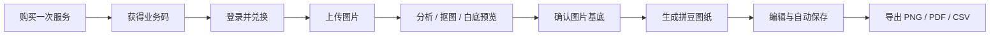
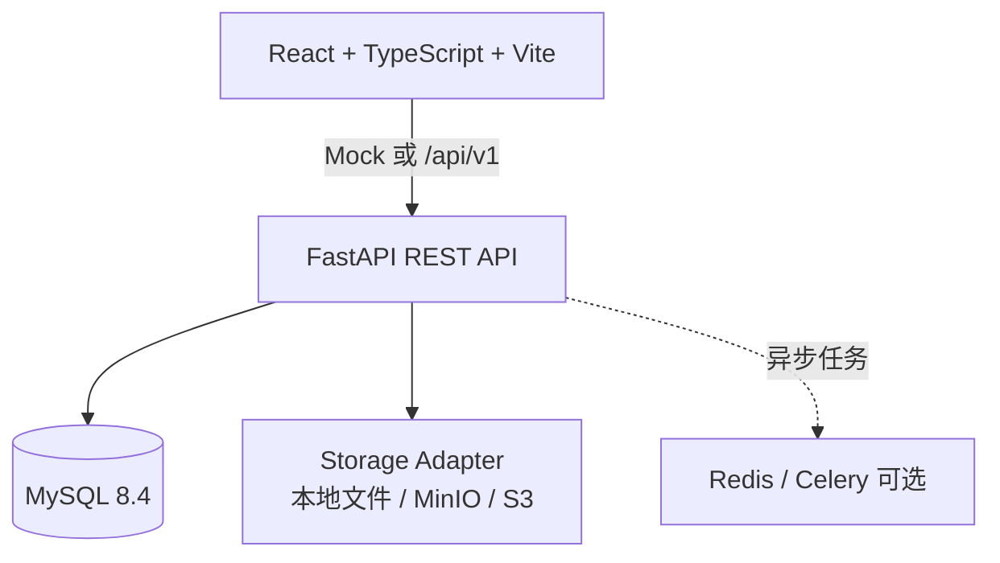

# PingDou · 拼豆图纸生成工作台

将一张图片转化为可执行的拼豆图纸：上传图片、智能抠图与白底处理、确认图像基底、生成带颜色编号和用量统计的网格图纸，并导出 PNG、PDF 或 CSV。

PingDou 面向一次性兑换场景设计：用户购买一次服务后获得一个业务码，兑换后生成一个项目和一张图纸。前端可以使用 Mock 模式独立演示，后端提供可切换的真实 API、MySQL 持久化和本地/对象存储适配层。

## 功能概览

- 图片上传与校验：格式、大小、尺寸和 SHA-256 元数据记录
- 图片分析：主体识别、抠图、白色背景预览和可替换的 AI 图像处理 Provider
- 基底确认：在生成图纸前确认最终使用的图片版本
- 拼豆图纸生成：网格尺寸、色板、颜色编号、每色豆子数量和总数统计
- 在线编辑：Canvas 2D 网格渲染、颜色替换、版本号校验和自动保存
- 导出：PNG 预览、PDF 打印图纸、CSV 材料清单
- 业务闭环：订单、业务码兑换、权益消耗、项目和任务状态管理
- 开发友好：前端 Mock/Real API 切换，后端可使用同步任务或 Redis/Celery

## 产品流程



## 系统架构



## 技术栈

### 前端

- React 19、TypeScript、Vite 7
- React Router、TanStack Query、Zustand
- React Hook Form、Zod、Tailwind CSS 工具链
- Canvas 2D 图纸编辑器
- MSW Mock、Vitest、Testing Library、ESLint

### 后端

- Python 3.11+、FastAPI、Pydantic Settings
- SQLAlchemy 2、Alembic、MySQL 8.4、PyMySQL
- Pillow、NumPy、scikit-image、ReportLab
- Redis/Celery（生产异步任务可选）
- 本地文件存储适配器，预留 MinIO/S3 适配
- Pytest、Ruff

## 项目结构

```text
PingDou/
├─ frontend/                     # React 前端工作台
│  ├─ src/                       # 页面、组件、状态、API 和编辑器
│  ├─ public/                    # 静态资源与 MSW worker
│  └─ README.md
├─ backend/                      # FastAPI 后端
│  ├─ app/
│  │  ├─ auth/                   # 登录与鉴权
│  │  ├─ orders/                 # 订单与支付回调
│  │  ├─ redemption/             # 业务码兑换与权益
│  │  ├─ projects/               # 项目与上传
│  │  ├─ imaging/                # 分析、抠图、白底与 Provider
│  │  ├─ patterns/               # 图纸生成、编辑与版本控制
│  │  ├─ exports/                # PNG/PDF/CSV 导出
│  │  ├─ domain/                 # 领域模型与访问控制
│  │  └─ core/                   # 配置、数据库、存储、任务基础设施
│  ├─ alembic/                   # 数据库迁移
│  ├─ scripts/                   # MySQL 初始化与开发种子数据
│  └─ README.md
├─ PRD.md
├─ API_接口文档.md
├─ Frontend_Development_Guide.md
└─ Backend_Development_Guide.md
```

## 快速开始

需要 Docker Desktop、Python 3.11+、Node.js 20+ 和 pnpm 11+。

### 1. 启动基础设施

```powershell
cd backend
docker compose up -d mysql redis minio
```

### 2. 启动后端

```powershell
cd backend
python -m venv .venv
.venv\Scripts\Activate.ps1
python -m pip install -e ".[dev]"
Copy-Item .env.example .env
alembic upgrade head
python -m scripts.seed
uvicorn app.main:app --reload --host 127.0.0.1 --port 8000
```

API 文档：<http://127.0.0.1:8000/docs>

如果使用本机已有的 MySQL 服务，先用管理员账号执行一次：

```powershell
cd backend
mysql.exe -u root -p -e "SOURCE scripts/mysql_bootstrap.sql"
alembic upgrade head
python -m scripts.seed
```

### 3. 启动前端

```powershell
cd frontend
pnpm install
pnpm dev
```

访问 <http://127.0.0.1:5173>。

默认前端使用 MSW Mock，可用开发账号登录：

| 项目 | 值 |
| --- | --- |
| 手机号 | `13800000000` |
| 验证码 | `123456` |
| 业务码 | `PD-TEST-CODE-FOR-DEV` |

连接真实后端时，在 `frontend/.env.local` 中设置：

```dotenv
VITE_API_MODE=real
VITE_API_BASE_URL=/api/v1
```

Vite 会将 `/api` 请求代理到 `http://127.0.0.1:8000`。

## 数据与图片存储

MySQL 只保存用户、项目、任务、图纸以及图片资产的元数据。图片和导出文件通过存储适配器保存，开发环境默认写入 `backend/storage/`，数据库保存 `storage_key`、MIME 类型、大小、尺寸、SHA-256 和处理元数据。

典型路径如下：

```text
users/{userId}/projects/{projectId}/source/{assetId}.png
users/{userId}/projects/{projectId}/derived/{assetId}.png
users/{userId}/projects/{projectId}/exports/{exportId}.pdf
```

生产环境可将 `app/core/storage.py` 替换为 MinIO/S3 实现；`backend/storage/` 已加入 `.gitignore`，不会被提交。

## 质量检查

```powershell
# 后端
cd backend
python -m compileall -q app tests scripts
python -m ruff check app tests scripts
python -m pytest

# 前端
cd frontend
pnpm lint
pnpm test
pnpm build
```

## 文档入口

- [产品需求文档](PingDou_PRD.md)
- [接口文档](API_Specification.md)
- [前端开发文档](Frontend_Development_Guide.md)
- [后端开发文档](Backend_Development_Guide.md)
- [前端本地说明](frontend/README.md)
- [后端本地说明](backend/README.md)

## 当前边界与演进方向

当前版本重点覆盖 P0 单次兑换和图纸生成闭环。AI 图片生成服务、正式支付渠道、对象存储和生产级异步队列均通过接口和 Provider 解耦，接入时无需改动核心图纸领域模型。后续可继续扩展更多色板品牌、批量生成、团队协作和打印规格模板。

## License

项目当前未指定开源许可证，默认保留所有权利。正式公开发布前请补充许可证文件。
